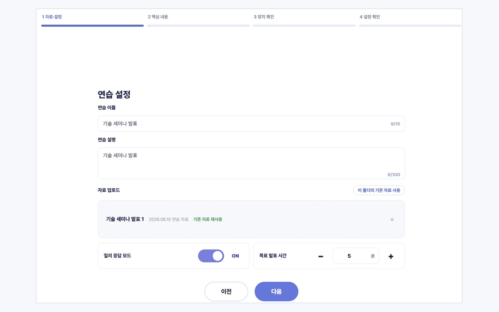
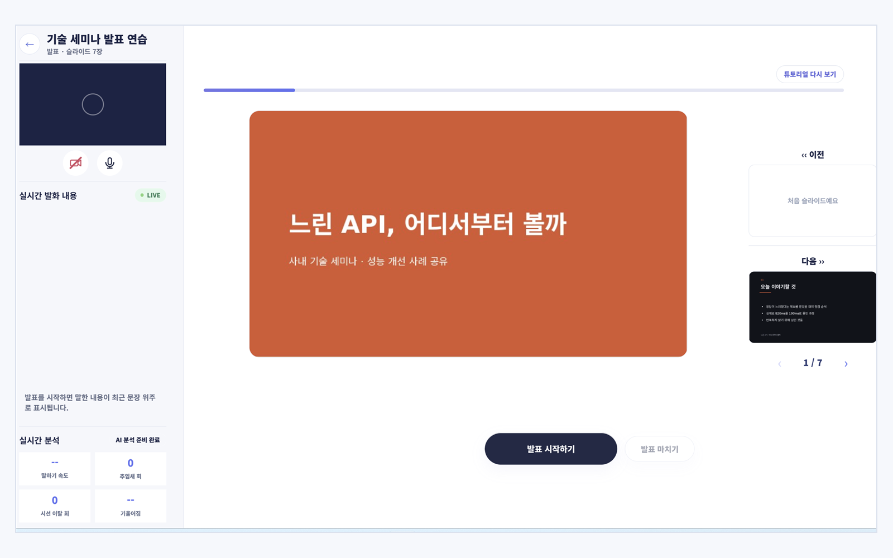
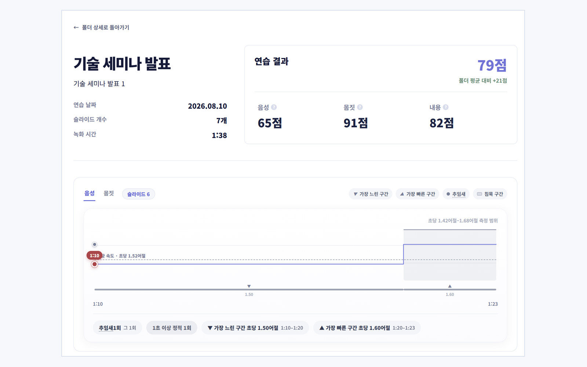
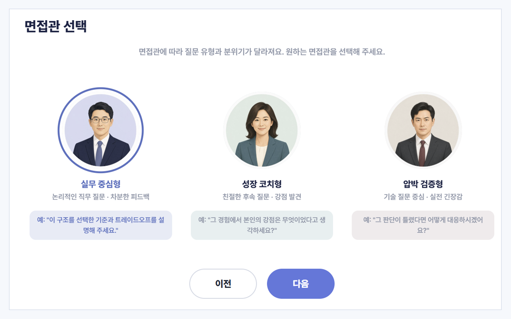
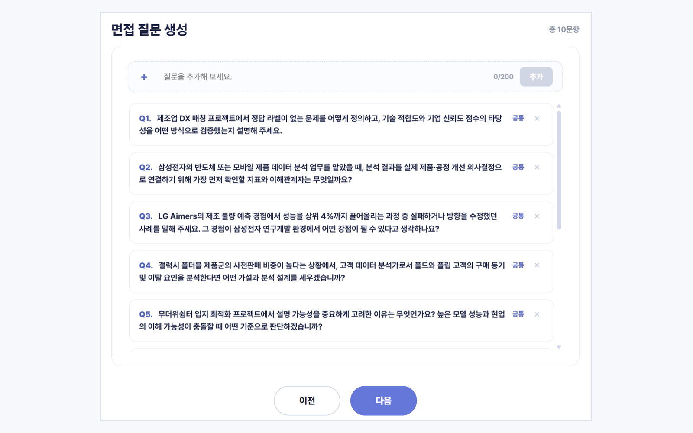
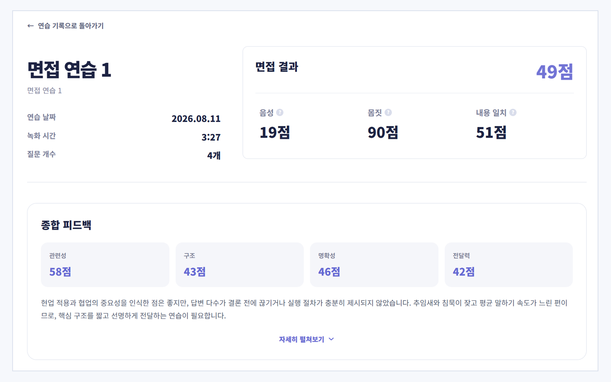

  <picture>
    <source media="(prefers-color-scheme: dark)" srcset="assets/aivo-logo-light.png" />
    <source media="(prefers-color-scheme: light)" srcset="assets/aivo-logo.png" />
    
  </picture>

<h1 align="center">AI 발표·면접 코칭 서비스</h1>

혼자 하는 연습에, 확신을 더하다.

  <a href="https://aivo.ai.kr">서비스 바로가기</a>
  &nbsp;·&nbsp;
  <a href="https://ssafy-pjt-presentation-source.vercel.app/">발표 자료 보기</a>

  SSAFY 15기 공통 프로젝트 &nbsp;·&nbsp; 2026.07–08 &nbsp;·&nbsp; 백구 &nbsp;·&nbsp; 6인 팀 
  <b>박민규 · AI Engineering</b> &nbsp;·&nbsp; SSAFY 공통프로젝트 발표회 3등

aivo는 발표·면접 연습의 음성·영상·답변을 분석해 맞춤 피드백과 누적 기록으로 연결하는 웹 코칭 서비스다. 이 저장소는 실제 서비스 화면과 핵심 구현을 소개하는 공개 포트폴리오다.

[개인 기여](#개인-기여) · [설계 결정](#ai-구현-및-의사결정) · [GPU 실행 결과](#ai-음성-분석-구현) · [사용자 피드백](#외부-유저-테스트) · [공개 코드·실행 범위](#공개-소스-범위)

## 개인 기여

**박민규 · 한국어 STT와 발화 분석 파이프라인 구현**

매끄러운 전사에서 빠지기 쉬운 짧은 필러를 찾아, 사용자가 고칠 말하기 습관을 시간 근거와 함께 보여주는 데 집중했다.

| 해결한 문제 | 직접 구현한 방식 | 코드·검증 근거 |
| --- | --- | --- |
| 짧은 필러 누락·중복 검출 | 전체 전사를 유지하면서 **8초 창 재전사**로 필러를 보완하고, **0.3초 이내 동일 검출**을 병합했다 | [필러 보완·병합](backend-fastapi-main/models/filer/src/presentation_coaching_filler_rescue.py) |
| 전사문만으로 구분하기 어려운 발화 습관 | 발화 구간(VAD)·피치·RMS와 단어별 발화 시각으로 필러·반복·쉼·말하기 속도를 분석하고 코칭 이벤트·점수를 산출했다 | [이벤트 분석](backend-fastapi-main/models/filer/src/presentation_coaching_events.py) · [점수 산출](backend-fastapi-main/models/filer/src/presentation_coaching_scoring.py) |
| 정상 음성 예시만으로 놓치는 경계 조건 | 합성 입력으로 필러 병합·재전사 창의 시각·침묵 구간을 회귀 검사했다 | [테스트 코드](backend-fastapi-main/tests/coaching/test_coaching.py) · [CI 실행 기록](https://github.com/scnelMG/aivo-portfolio/actions/workflows/coaching-tests.yml) |

공개 회귀 검사는 로직의 기대 동작을 확인한다. 실제 음성 탐지 성능과 발표 당시의 비교 수치는 아래 [발표 평가 기록](#직접-라벨링한-발표-평가)에서 별도로 다룬다.

## 문제

혼자 발표나 면접을 연습하면 **무엇을 고쳐야 하는지**, **이전보다 나아졌는지**, **실전에서 드러날 습관은 무엇인지**를 즉시 판단하기 어렵다. aivo는 피드백 공백, 기록의 단절, 실전 불안을 하나의 연습 경험 안에서 다룬다.

## aivo의 해결

발표 자료 또는 면접 맥락을 바탕으로 연습하고, 발화·시선·자세·내용을 함께 살펴본 뒤, 결과를 다음 연습에 활용할 수 있는 기록으로 남긴다. 사용자는 한 번의 결과가 아니라 반복에서 생기는 변화를 확인한다.

## 핵심 기능

### 01. 발표 연습 — 자료 설정부터 실시간 코칭까지

발표 제목·설명과 자료를 입력하고, 기존 자료 재사용·질의응답 모드·목표 발표 시간을 설정한다. 발표 중에는 현재 슬라이드와 실시간 발화 내용을 보며 말하기 속도·추임새·시선·기울어짐을 한 화면에서 확인한다.

  
  

### 02. 발표 리포트 — 음성·몸짓·내용을 슬라이드별로

연습이 끝나면 음성·몸짓·내용 점수와 구간별 말하기 속도, 추임새·침묵 같은 근거를 확인한다. 사용자는 개선이 필요한 순간을 찾아 다음 발표의 목표로 연결할 수 있다.

  

### 03. AI 면접 — 면접관과 질문을 내 맥락에 맞게

원하는 면접관 페르소나를 선택하고, 직무·경험·지원 맥락을 반영한 질문을 생성해 면접을 진행한다. 같은 이력이라도 면접관의 성향에 따라 다른 방식으로 연습할 수 있다.

직무와 경력을 기본으로 회사·JD·자기소개서·포트폴리오를 선택 입력받는다. LLM이 문서에서 프로젝트·기술·경험과 추가 확인이 필요한 근거를 정리한 뒤, 공통·인성·직무 기본 질문을 포함하는 규칙 기반 구성을 확정한다. 이후 AI Hub 채용면접 데이터의 직군별 질문 유형을 참고해, 사용자의 맥락에 맞는 질문과 확인 포인트를 생성한다.

  
  

### 04. 면접 리포트 — 답변 내용과 전달력을 함께

면접 결과를 음성·몸짓·내용 일치 관점에서 종합하고, 관련성·구조·명확성·전달력에 대한 피드백을 제공한다. 숫자로 끝나지 않고 다음 답변에서 보완할 점을 확인할 수 있다.

  

## 연습 → 분석 → 기록

> **연습 흐름**: 연습 준비 → 발표·면접 연습 → 음성·영상·답변 분석 → 맞춤 리포트 → 기록 비교와 다음 목표

| 단계 | 사용자가 얻는 경험 |
| --- | --- |
| 연습 | 발표 자료·대본 또는 면접 맥락을 준비하고 말해 본다. |
| 분석 | 말하기 습관과 비언어적 표현, 답변 내용을 함께 확인한다. |
| 기록 | 결과를 비교해 다음 연습에서 집중할 목표를 정한다. |

## 직접 라벨링한 발표 평가

발표 당시의 비교 기록이다. 표본·계산식·측정 환경의 공개 근거가 제한돼 있어, 현재 구현과 회귀 검사 결과와 구분한다.

발표 당시 수치와 확인 범위 보기

박민규가 직접 라벨링한 자료를 기준으로 평가한 결과를 [최종 발표자료](https://ssafy-pjt-presentation-source.vercel.app/)의 기술 소개에서 제시했다.

| 발표 평가 항목 | 비교 모델 | aivo | 변화 |
| --- | ---: | ---: | ---: |
| 탐지 정확도 | 모델 A: 5.5% | 76% | +70.5%p |
| 발화 분석 시간 | 모델 B: 41.5초 | 4.3초 | 약 9.6배 빠름 |

발표 뷰어의 22번 화면(탐지 정확도), 23–24번 화면(발화 분석 시간)에서 확인할 수 있다. `O` 목록에서는 원본 슬라이드 30–32번이다. 지표명은 발표자료의 표기를 따르며, 이를 별도의 precision·recall·F1로 바꾸어 해석하지 않는다.

모델명, 평가 표본과 계산 기준의 확인 범위는 [발표 평가 수치와 확인 범위](docs/evaluation.md)에 정리했다.

아래 GPU 스모크 실행은 별도의 실험 기록이다. 발표자료의 **발화 분석 시간 4.3초**와 아래 **전사 시간 8.731초**는 서로 다른 측정 기록이므로 같은 실행의 수치로 합치지 않는다.

## AI 음성 분석 구현

한국어 발표에서는 문법적으로 매끄러운 전사보다 실제 발화의 필러·반복·쉼을 보존하는 것이 중요했다. `faster-whisper-large-v3-turbo`의 단어별 발화 시각이 포함된 전사를 바탕으로, 짧은 필러를 보완하기 위한 8초 재전사와 0.3초 이내 중복 병합을 구현했다. 이후 Silero VAD·피치·RMS 연속성으로 필러·반복·긴 쉼·늘여 말하기·말하기 속도를 근거와 함께 코칭 이벤트로 만들었다.

| 실제 GPU 스모크 실행 | 결과 |
| --- | ---: |
| 실행 모델 | `faster-whisper-large-v3-turbo` (`int8_float16`) |
| 단어 타임스탬프 | **139개** |
| 생성 코칭 이벤트 | **8개** |
| 전사 시간 | **8.731초** |
| Real-time factor | **0.0751** (약 13.3배 빠른 전사) |
| 검증 이력 | 실험 당시 발표 코칭 테스트 **27 passed** |

> NVIDIA GeForce RTX 4050 Laptop GPU에서 단일 한국어 발표 음성을 실행한 실험 결과다. 전사 시간과 자원 사용량은 오디오 길이·GPU·모델 캐시 상태에 따라 달라진다. `27 passed`는 해당 실험 시점의 발표 코칭 테스트 검증 이력이다. 분석 결과는 발표 코칭을 위한 지표이며 의료적 진단에 사용하지 않는다.

## AI 구현 및 의사결정

**박민규 · AI**

발표·면접 코칭에서 필요한 것은 문법적으로 매끄러운 받아쓰기가 아니라, 사용자가 실제로 보완해야 할 필러·반복·쉼을 시간 근거와 함께 찾는 일이었다. 이를 위해 전사, 음성 구간 분석, 피드백 생성이 이어지는 파이프라인을 설계·구현했다.

| 과제 | 해결 방식 | 포트폴리오 근거 |
| --- | --- | --- |
| 짧은 필러 누락 | 전체 전사를 기준으로 유지하고 8초 독립 창 재전사 결과를 병합 | 필러를 보존하면서 문맥 단절을 줄임 |
| 중복된 필러 검출 | 0.3초 이내 동일 검출을 하나의 이벤트로 병합 | 사용자에게 과도한 감점·중복 피드백을 방지 |
| 쉼과 늘여 말하기 구분 | Silero VAD, 피치, RMS 연속성과 시간 기준을 함께 사용 | 시간·근거·신뢰도를 가진 코칭 이벤트 생성 |
| 내용과 전달력의 혼합 | LLM 답변 피드백과 비유창성 분석을 분리 | 면접 리포트에서 답변 내용과 말하기 습관을 각각 개선 |

### 모델 탐색과 최종 선택

한 모델의 전사문만 보고 결정하지 않기 위해 `faster-whisper` 2종, CrisperWhisper 2종, SeloWhisper, Tellang Whisper까지 **6개 후보**를 같은 벤치마크 규격에 연결했다. 모델별로 로드·전사·이벤트 분석 시간과 CPU·RAM·GPU·VRAM, Real-time factor를 같은 형식으로 수집하도록 만들었다.

최종 기본 모델은 `faster-whisper-large-v3-turbo`이다. 다른 후보보다 절대적으로 정확하다고 단정해서가 아니라, 한국어 단어 타임스탬프를 제공하고 실제 RTX 4050 GPU에서 전사부터 코칭 이벤트 생성까지 끝까지 검증된 후보였기 때문이다. CrisperWhisper와의 짧은 비교 오디오에서는 결과 차이를 확인했지만, 정답 전사가 없는 비교였으므로 정확도 우열의 근거로 사용하지 않았다.

> 모델 선택 기준은 실서비스 파이프라인의 실행 가능성, 단어 시각 근거, 자원 측정 가능성이다. 위 스모크·탐색 기록과 직접 라벨링한 최종 발표 평가를 구분하며, 발표자료에서 익명화한 모델 A·B를 특정 모델 이름에 임의로 대응시키지 않는다.

### 검증 범위

GPU 스모크 실행의 측정값과 당시 테스트 이력은 [위 표](#ai-음성-분석-구현)에 정리했다.

> 수치는 특정 GPU·오디오 조건에서의 실행 결과이며, 사용자 점수의 절대적 정확도를 뜻하지 않는다. 리포트는 연습 방향을 제안하는 코칭 도구로 설계했다.

현재 공개 코드의 회귀 검사는 [Coaching tests](https://github.com/scnelMG/aivo-portfolio/actions/workflows/coaching-tests.yml)에서 커밋별로 확인할 수 있다. 필러 병합·중복 제거·재전사 창의 시각·침묵 구간·리뷰 집계를 CPU에서 검사하며, 실험 당시 `27 passed`와는 별도다. 실행 방법은 [공개 소스 스냅샷](SOURCE_SNAPSHOT.md#공개-코드-회귀-테스트)에 있다.

## 외부 유저 테스트

aivo는 SSAFY 공통 프로젝트 유저 테스트 프로그램에 선정되어, 삼성 경력사원 임직원이 서비스를 체험하고 작성한 피드백을 받았다. 이 경험은 기능을 만들었다는 사실을 넘어, 실제 사용자가 어디에서 결과를 이해하기 어렵고 다음 행동을 망설이는지를 확인하는 검증 과정이었다.

유저 테스트 리포트에는 **17건**의 피드백이 기록되었으며, 우선 검토가 필요한 Major **10건**, 경험 개선을 위한 Minor **7건**으로 분류되었다. 피드백은 UI·접근성, 리포트 탐색·동기화, AI 피드백 해석·개인화, 업로드·준비 흐름에 집중되었다.

> 이 결과는 피드백을 수집한 사실과 개선 기회를 보여준다. 모든 항목을 해결했거나 서비스 효과가 검증되었다는 뜻은 아니다. 익명화한 상세 정리는 [외부 유저 테스트](docs/user-testing.md)에서 확인할 수 있다.

## 공개 소스 범위

이 저장소는 운영 서비스 전체를 복제한 실행 레포가 아니라, 실제 서비스 화면과 핵심 구현을 검토할 수 있도록 정리한 공개 스냅샷이다. 특히 박민규가 담당한 발표 음성 분석 코드는 [`models/filer/src/`](backend-fastapi-main/models/filer/src/)에서 확인할 수 있다.

- **검토 가능한 구현**: 한국어 단어 타임스탬프 전사, 8초 재전사 기반 필러 보완, VAD·피치·RMS 기반 발화 이벤트·점수 산출
- **공개하지 않은 운영 요소**: 환경 변수, 사용자 음성·영상, 모델 가중치, DB·메시지 브로커·클라우드 연결 설정, 배포·CI 구성
- **스냅샷 내 인터페이스 코드**: 일부 API 폴백·메시지 작업자에는 계약 검토와 화면 데모를 위한 목업 또는 후속 구현 TODO가 포함된다. 이를 실제 추론·운영 결과로 주장하지 않는다.

따라서 이 저장소는 코드 리뷰와 포트폴리오 열람을 위한 자료이며, 실행 가능 범위와 제외 항목은 [공개 소스 스냅샷](SOURCE_SNAPSHOT.md)에서 확인할 수 있다.

## 기술 스택

| 영역 | 기술 |
| --- | --- |
| Web | Vue 3, Vite, Pinia, Vue Router |
| Media | MediaPipe, Web Audio API |
| Application | Java, Spring Boot, Spring Security, Spring Data JPA, WebSocket |
| AI | faster-whisper-large-v3-turbo, LLM, MediaPipe Tasks Vision, Silero VAD |
| Data | PostgreSQL, Redis, RabbitMQ |
| Team delivery history | Docker, GitHub Actions, GitHub Container Registry, Spring Boot Actuator (운영 설정은 공개하지 않음) |

## 아키텍처

아래는 팀이 구성한 서비스 아키텍처다. 이 공개 스냅샷에는 운영 배포·CI 설정과 연결 정보가 포함되지 않으므로, 다이어그램의 모든 구성 요소를 이 저장소만으로 실행할 수 있다는 뜻은 아니다.

> **연동 구조**: 사용자 → Vue 3 웹 클라이언트(MediaPipe·Web Audio API) ↔ Spring Boot API → PostgreSQL·Redis·RabbitMQ → STT·LLM·비전 분석 워커 → 맞춤 리포트. GitHub Actions·GHCR·Docker·Actuator는 배포·상태 점검 흐름을 담당한다.

## Team 백구

aivo는 아래 6명이 함께 만든 프로젝트다.

| 역할 | 팀원 |
| --- | --- |
| Backend | 최현철 · 윤성빈 · 채승규 |
| Frontend | 서가은 |
| AI | 박민규 |
| Infrastructure | 윤재용 |

## 링크

- [aivo 서비스](https://aivo.ai.kr)
- [aivo 발표 자료](https://ssafy-pjt-presentation-source.vercel.app/)
- [공개 소스 스냅샷](SOURCE_SNAPSHOT.md)
- [포트폴리오 근거 지도](docs/evidence-map.md)
- [외부 유저 테스트 요약](docs/user-testing.md)

## 이용 안내

이 저장소는 포트폴리오·학습 기록 열람을 위해 공개한다. 코드·문서·이미지의 재사용, 수정, 배포는 사전 문의가 필요하다.
